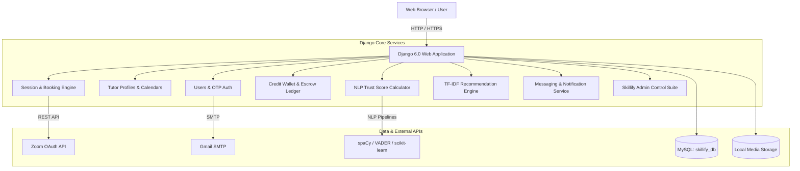

# Skillify 🚀

> **A peer-to-peer skill exchange and collaborative learning platform powered by a virtual credit economy, automated video sessions, an NLP-based trust scoring engine, and intelligent recommendations.**

[](https://www.python.org/)
[](https://www.djangoproject.com/)
[](https://www.mysql.com/)
[](https://getbootstrap.com/)
[](LICENSE)

---

## 📌 Table of Contents

- [Overview](#-overview)
- [Key Features](#-key-features)
  - [1. User Management & Dual Roles](#1-user-management--dual-roles)
  - [2. Virtual Credit Economy & Wallet](#2-virtual-credit-economy--wallet)
  - [3. Session & Booking Lifecycle](#3-session--booking-lifecycle)
  - [4. AI & NLP-Powered Tutor Trust Score](#4-ai--nlp-powered-tutor-trust-score)
  - [5. Intelligent Recommendation Engine](#5-intelligent-recommendation-engine)
  - [6. Real-Time Messaging & Notifications](#6-real-time-messaging--notifications)
  - [7. Dispute Resolution & Admin Control Suite](#7-dispute-resolution--admin-control-suite)
- [System Architecture](#-system-architecture)
- [Tech Stack](#-tech-stack)
- [Project Structure](#-project-structure)
- [Getting Started](#-getting-started)
  - [Prerequisites](#prerequisites)
  - [Installation & Setup](#installation--setup)
  - [Configuration (.env)](#configuration-env)
  - [Database & Migrations](#database--migrations)
  - [Running the Application](#running-the-application)
- [Environment Variables](#-environment-variables)
- [Management Commands](#-management-commands)
- [Contributing & License](#-contributing--license)

---

## 📖 Overview

**Skillify** is a collaborative learning marketplace designed to eliminate monetary barriers in peer education. Instead of fiat currency, Skillify operates on an **escrow-backed virtual credit economy**:
- Users earn credits by teaching topics they excel at.
- They spend earned credits to book personalized 1-on-1 or group learning sessions from other skilled tutors.
- An **NLP-driven Trust Score** dynamically evaluates tutors based on review sentiments, bio-to-skill lexical matching, completion consistency, and community recommendations.
- Sessions automatically integrate with **Zoom** for hassle-free video conferencing with strict completion verification and safety policies.

---

## ✨ Key Features

### 1. User Management & Dual Roles
- **Dual Role Architecture:** Users can switch between **Learner** and **Tutor** modes at any time.
- **Email OTP Verification:** 6-digit numeric one-time password verification on registration and password resets via Gmail SMTP.
- **Tutor Profile Showcases:** Dynamic 2-week availability calendar, verified credential/certificate uploads, embeddable demo videos (YouTube, Vimeo, Loom, Google Drive), social links (GitHub, LinkedIn), and bio separation for teaching vs. learning.

### 2. Virtual Credit Economy & Wallet
- **100 Welcome Credits:** Automatically awarded to new users upon account verification.
- **Smart Escrow System:** Credits are safely frozen when a learner books a session and held in escrow until the session is completed.
- **Auto-Transfer & Refunds:** Instant credit payout to the tutor upon verified completion, or 100% refund to the learner on valid cancellation.
- **Audit Ledger:** Complete transaction history tracking deposits, earnings, spends, frozen holds, and refunds with one-click **CSV export**.

### 3. Session & Booking Lifecycle
- **Session Types:** Supports both **1-on-1** and **Group Sessions** with custom maximum participant limits and skill level tags (`Beginner`, `Intermediate`, `Advanced`).
- **Automated Zoom Integration:** Generates meeting IDs, host links, and join links via Zoom Server-to-Server OAuth 15 minutes prior to session start.
- **80% Duration Rule:** Enforces that both parties spend at least 80% of scheduled session time before completion can be submitted.
- **24-Hour Auto-Completion:** Automatically finalizes uncontested sessions and releases escrow credits if one party forgets to manually mark complete.
- **Fair Cancellation & Reschedule Policies:**
  - Learners can cancel up to 2 hours before start for an automated 100% refund.
  - Tutors can propose rescheduling up to 12 hours before start; learners can accept or decline before the 1-hour deadline.

### 4. AI & NLP-Powered Tutor Trust Score
Every tutor receives an adaptive, multi-factor **Trust Score (0–100 points)** categorized into 6 tiers (*New*, *Beginner*, *Developing*, *Established*, *Expert*, *Master Tutor*):
- **Session Performance (30 pts):** Completion rate, total sessions taught, unique students taught, cancellation penalties.
- **Review Metrics (28 pts):** Bayesian weighted average ratings, review volume, recommendation percentage, and repeat bookings.
- **NLP Sentiment Analysis (10 pts):** Uses `vaderSentiment` compound polarity scoring on student reviews with consistency checks.
- **NLP Bio-Skill Match (10 pts):** Employs `spaCy` linguistic lemmatization and noun chunk analysis to verify that tutor bios match their listed skills.
- **Profile Genuineness & Completion (22 pts):** Verified certificates, demo videos, avatar, portfolio links, and skill depth.
- **Spam / Duplicate Penalty:** Penalizes review manipulation and duplicate feedback.

### 5. Intelligent Recommendation Engine
- **Progression-Based Matching:** Recommends next-level sessions based on past completions (e.g. finishes *Beginner Python* $\rightarrow$ suggested *Intermediate Python*).
- **Interest-Based Matching:** Uses **TF-IDF Vectorization** and **Cosine Similarity** (`scikit-learn`) over user learning interests, past bookings, and session descriptions.
- **Similar Tutors:** Suggests peer tutors on tutor profile pages combining text similarity (70%) and trust scores (30%).

### 6. Real-Time Messaging & Notifications
- **Booking-Gated Messaging:** Users with mutual bookings can communicate directly via a dedicated chat interface.
- **File Sharing:** Securely upload and exchange images and PDF/Word documents (up to 5MB).
- **In-App & Email Notifications:** Real-time navbar alerts with 30-second polling for bookings, reschedules, messages, disputes, and reviews.

### 7. Dispute Resolution & Admin Control Suite
- **Formal Dispute Filing:** Learners or tutors can lodge disputes for no-shows, technical failures, or misbehavior with uploaded evidence files/URLs.
- **Custom Staff Admin Portal (`/skillify-admin/`):**
  - **7 Live Analytics Charts:** User growth, booking trends, skill popularity, top earners, trust score distribution, completion rates, and credit flow.
  - **Management Tools:** User suspension/deletion, tutor audits, session monitoring, dispute arbitration (with one-click credit refunds), and platform-wide announcement broadcasts.

---

## 🏗 System Architecture



---

## 💻 Tech Stack

| Layer | Technologies |
|---|---|
| **Backend Framework** | [Django 6.0.2](https://www.djangoproject.com/), Python 3.12 |
| **Database** | [MySQL](https://www.mysql.com/) (Connector: `mysqlclient`) |
| **Frontend** | HTML5, CSS3, JavaScript (Vanilla ES6+), [Bootstrap 5.3](https://getbootstrap.com/), [Bootstrap Icons](https://icons.getbootstrap.com/) |
| **Typography** | Inter, Plus Jakarta Sans |
| **NLP & Machine Learning** | [spaCy](https://spacy.io/) (`en_core_web_sm`), [vaderSentiment](https://github.com/cjhutto/vaderSentiment), [scikit-learn](https://scikit-learn.org/) |
| **Video Conferencing** | [Zoom Server-to-Server OAuth REST API](https://marketplace.zoom.us/docs/guides/build/server-to-server-oauth-app/) |
| **Email Delivery** | Gmail SMTP (TLS Port 587) |
| **Configuration** | [python-decouple](https://github.com/HBNetwork/python-decouple) |

---

## 📁 Project Structure

```text
skillify_project/
├── core/                   # Wallet, transactions, dashboard views
├── disputes/               # Dispute filing, evidence, and response models
├── messaging/              # Direct chat conversations, message attachments
├── notifications/          # In-app notification engine and badge counts
├── profiles/               # Tutor profiles, certificates, 2-week calendar
├── reviews/                # Reviews, star ratings, and recommendation tags
├── session/                # Session creation, booking lifecycle, Zoom API
├── skillify_admin/         # Dedicated staff control panel, charts, analytics
├── skillify_project/       # Root project configuration (settings, urls, wsgi)
├── skills/                 # Skill categories and browse directory
├── static/                 # Static CSS, JS libraries, and brand assets
├── templates/              # HTML Django templates
├── trust/                  # Trust score calculation, NLP analysis, recommendations
│   ├── calculator.py       # Multi-factor trust scoring algorithm
│   ├── nlp.py              # VADER sentiment and spaCy NLP pipeline
│   └── recommender.py      # TF-IDF & progression-based recommendation engine
├── users/                  # Custom authentication, OTP verification, UserProfile
├── media/                  # User uploads (ignored by git, preserved with .gitkeep)
├── .env.example            # Environment configuration template
├── .gitignore              # Git ignore rules for virtualenvs, media, and secrets
├── manage.py               # Django management script
├── requirements.txt        # Python dependency manifest
└── README.md               # Project documentation
```

---

## 🚀 Getting Started

### Prerequisites

Ensure you have the following installed on your machine:
- **Python 3.12+**
- **MySQL Server 8.0+**
- **Git**

---

### Installation & Setup

#### 1. Clone the repository
```bash
git clone https://github.com/YOUR_USERNAME/skillify_project.git
cd skillify_project
```

#### 2. Create and activate a virtual environment
```powershell
# Windows (PowerShell)
python -m venv venv
.\venv\Scripts\Activate.ps1

# Linux / macOS
python3 -m venv venv
source venv/bin/activate
```

#### 3. Install dependencies
```bash
pip install -r requirements.txt
python -m spacy download en_core_web_sm
```

---

### Configuration (.env)

Copy the sample environment file to create your local `.env`:
```powershell
cp .env.example .env
```

Open `.env` and configure your credentials:
```env
SECRET_KEY=your-custom-django-secret-key
DEBUG=True
ALLOWED_HOSTS=127.0.0.1,localhost

# MySQL Database
DB_NAME=skillify_db
DB_USER=root
DB_PASSWORD=your_mysql_password
DB_HOST=localhost
DB_PORT=3306

# Email Settings (Gmail App Password)
EMAIL_HOST_USER=your_email@gmail.com
EMAIL_HOST_PASSWORD=your_gmail_app_password
DEFAULT_FROM_EMAIL=Skillify <your_email@gmail.com>

# Zoom OAuth API Credentials (Server-to-Server App)
ZOOM_ACCOUNT_ID=your_zoom_account_id
ZOOM_CLIENT_ID=your_zoom_client_id
ZOOM_CLIENT_SECRET=your_zoom_client_secret
```

---

### Database & Migrations

#### 1. Create the MySQL Database
Log into MySQL and create the database:
```sql
CREATE DATABASE skillify_db CHARACTER SET utf8mb4 COLLATE utf8mb4_unicode_ci;
```

#### 2. Run Migrations
```bash
python manage.py migrate
```

#### 3. Create a Superuser / Admin
```bash
python manage.py createsuperuser
```

---

### Running the Application

Start the Django development server:
```bash
python manage.py runserver
```

Open your browser and navigate to:
- **Learner/Tutor App:** `http://127.0.0.1:8000/`
- **Skillify Admin Suite:** `http://127.0.0.1:8000/skillify-admin/`
- **Django Standard Admin:** `http://127.0.0.1:8000/admin/`

---

## ⚙️ Environment Variables

| Variable | Description | Default |
|---|---|---|
| `SECRET_KEY` | Django cryptographic secret key | *Required* |
| `DEBUG` | Enables/disables debug mode (`True`/`False`) | `True` |
| `ALLOWED_HOSTS` | Comma-separated list of allowed hostnames | `*` |
| `DB_NAME` | MySQL database name | `skillify_db` |
| `DB_USER` | MySQL username | `root` |
| `DB_PASSWORD` | MySQL password | *Empty* |
| `DB_HOST` | MySQL host address | `localhost` |
| `DB_PORT` | MySQL port number | `3306` |
| `EMAIL_HOST_USER` | Gmail address for outgoing system emails | *Empty* |
| `EMAIL_HOST_PASSWORD` | Gmail 16-character App Password | *Empty* |
| `DEFAULT_FROM_EMAIL` | Display sender in outgoing emails | `Skillify <noreply@skillify.com>` |
| `ZOOM_ACCOUNT_ID` | Zoom Server-to-Server OAuth Account ID | *Empty* |
| `ZOOM_CLIENT_ID` | Zoom Server-to-Server OAuth Client ID | *Empty* |
| `ZOOM_CLIENT_SECRET` | Zoom Server-to-Server OAuth Client Secret | *Empty* |

---

## 🛠 Management Commands

### Recalculate Trust Scores
Recalculate and update trust scores across all tutors in the database:
```bash
python manage.py recalculate_trust
```

---

## 📄 Contributing & License

This project was built for academic and portfolio demonstration. Feel free to fork, customize, and submit pull requests.

Distributed under the **MIT License**. See `LICENSE` for more information.

